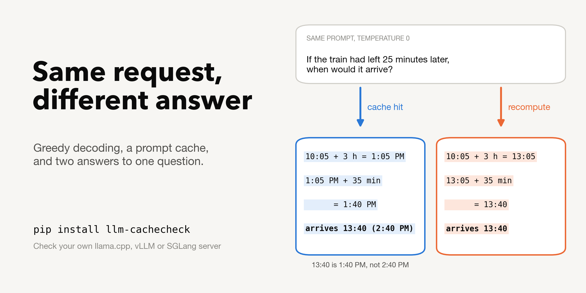
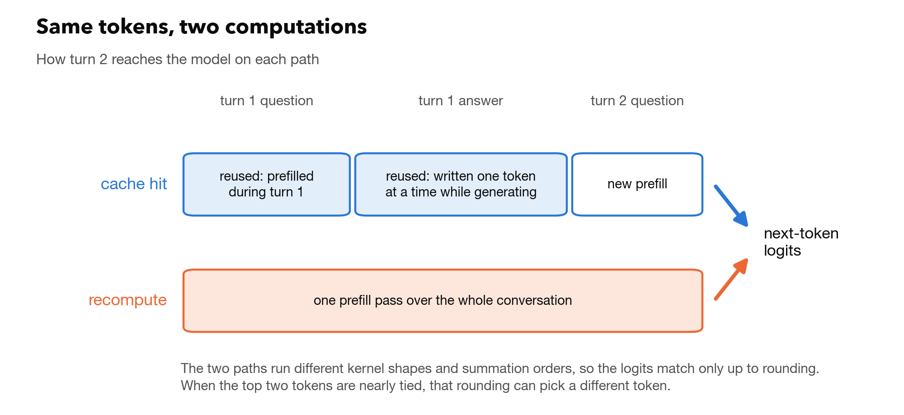
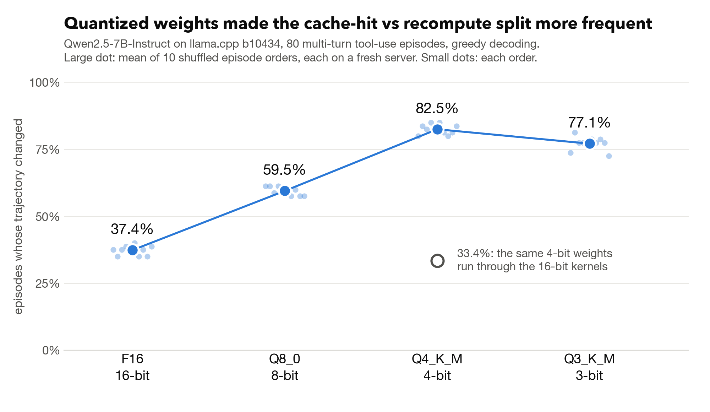
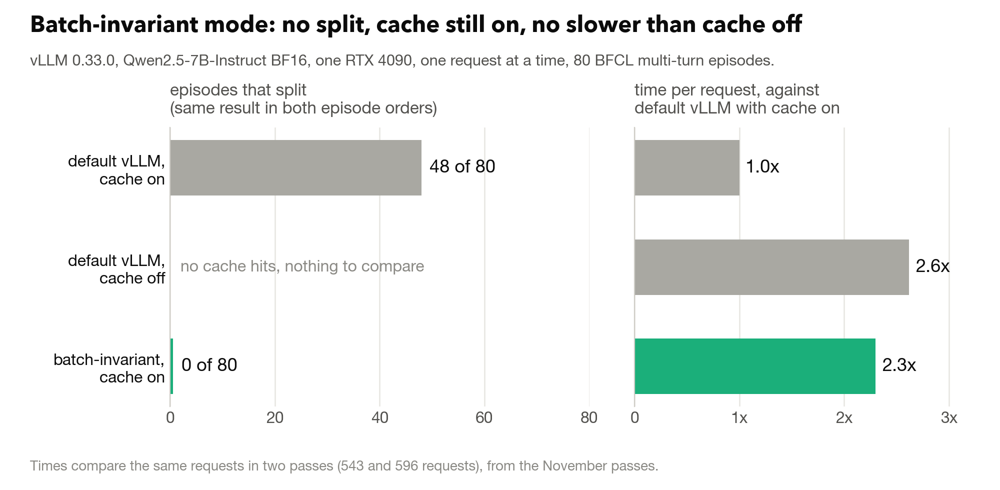

# Your prompt cache can change your model's answer. Here's how to check.



**TL;DR**

- **The cache changes answers.** At temperature 0 and one request at a time, a prompt-cache hit and a recompute of the same prompt can return different text. Others have reported this on vLLM and SGLang. I measured how often it happens, what makes it worse and what removes it. With the cache off, every run in my study repeated exactly.
- **Quantization makes it more frequent on llama.cpp.** 37.4% of multi-turn agent episodes changed at 16-bit and 82.5% at 4-bit (Qwen2.5-7B, averaged over ten shuffled episode orders).
- **vLLM's batch-invariant mode removes it with the cache on.** 0 of 80 episodes changed against 48 of 80 by default on vLLM 0.33.0, in two episode orders. At batch size one it was no slower than turning the cache off.
- **You can check your own server.** `pip install llm-cachecheck` works with llama.cpp, vLLM and SGLang, needs one server, and can use your own conversations.

**Resources:** [paper (IEEE Access)](https://doi.org/10.1109/ACCESS.2026.3749922) · [arXiv](https://arxiv.org/abs/2609.04748) · [Hugging Face paper page](https://huggingface.co/papers/2609.04748) · [code and data](https://github.com/aditi-p31/cache-divergence-study) · [llm-cachecheck on PyPI](https://pypi.org/project/llm-cachecheck/)

## Two answers to one question

I served Qwen2.5-3B-Instruct with vLLM 0.33.0 and asked it a two-turn question at temperature 0. First: "A train leaves at 9:40 and arrives at 13:15. How long is the trip? Show your steps." Then: "If the train had left 25 minutes later and travelled at the same speed, when would it arrive? Explain briefly."

When turn 2 reused the cache that turn 1 had left behind, the model switched to 12-hour time and got one conversion wrong (13:40 is 1:40 PM, not 2:40 PM) before closing on the right time:

```text
10:05 + 3 hours = 1:05 PM
1:05 PM + 35 minutes = 1:40 PM

Therefore, if the train had left 25 minutes later at 10:05, it would arrive at 13:40 (2:40 PM).

So, the new arrival time would be 13:40.
```

When the server computed the same conversation from scratch, it stayed in 24-hour time:

```text
10:05 + 3 hours = 13:05
13:05 + 35 minutes = 13:40

Therefore, if the train had left 25 minutes later at 10:05, it would arrive at 13:40.
```

These are excerpts of the model's own lines, with the LaTeX and Markdown markup removed. Each path gave exactly the same text in all eight of its runs.

Both runs used the same weights, prompt and sampling settings, and the server handled one request at a time. The only difference was whether part of the prompt came from the cache. That matters wherever you expect a rerun to match: evals, regression tests, agent benchmarks and debugging sessions.

Neither path is better in general. Here the cached answer has the slip, but on a 500-question math check in my paper, answers that flipped went both ways (13 toward the cache hit, 7 toward the recompute), with no detectable net change in accuracy. The cost is reproducibility, because the answer depends on cache state that the request does not show.

The effect itself is known. vLLM users have reported it in the issue tracker, a NeurIPS 2026 workshop poster shows it on an agent benchmark, and the Thinking Machines post on nondeterminism explains the cause and the batch-invariant fix (links below). This post adds measurements from my paper and from follow-up runs this month: how much quantization amplifies it, a second source in llama.cpp's server-level cache, what vLLM's batch-invariant mode costs with caching on compared with caching off, and a tool that checks your own server.

## Why a cache hit is a different computation



*The middle block is the one that matters: on a cache hit, turn 1's answer is reused as it was written during generation, one token at a time, while a recompute prefills it in a single pass.*

Prefix caching keeps the key-value (KV) entries of a prompt, so the next request that starts the same way can skip that work. vLLM calls it prefix caching, SGLang uses a radix cache, and llama.cpp has `cache_prompt`. All three have it on by default. In a chat, turn 2 begins with turn 1's prompt and answer, so it is almost always a hit.

The cached entries for turn 1's answer were written while the model generated it, one token at a time. A recompute processes the whole conversation in one prefill pass. The two passes run with different kernel shapes and summation orders, so the floating-point results differ in the last bits. Horace He's post at Thinking Machines, [Defeating Nondeterminism in LLM Inference](https://thinkingmachines.ai/blog/defeating-nondeterminism-in-llm-inference/), explains why kernel results depend on batch shape, and names prefix caching among the cases a batch-invariant attention kernel has to handle. The [llama.cpp server README](https://github.com/ggml-org/llama.cpp/blob/master/tools/server/README.md) says that enabling `cache_prompt` "can cause nondeterministic results".

A difference that small only matters when the top two tokens are nearly tied. On llama.cpp at Q4_K_M, tokens whose top-two logit margin was under 0.01 flipped in 2 of 3 cases, and tokens with a margin above 3 flipped in 0 of 8,038. Once a single token flips, greedy decoding follows a different path, and in an agent loop a different string can mean a different tool call.

## How often it happens

For my paper, [Same Request, Different Answer](https://doi.org/10.1109/ACCESS.2026.3749922), I ran 80 multi-turn tool-use episodes from BFCL, about ten requests each, on llama.cpp and vLLM. The runs used rented RTX 4090s, greedy decoding and one request at a time, with prefix reuse on and off. An episode counts as split when any of its requests returns different text on the cache-hit path than on the recompute path, after which the rest of the episode can go its own way. The main llama.cpp sweep ran in ten shuffled episode orders, each on a fresh server, because what a server has already handled can matter (more on that below).

- **Prefix reuse off:** every repeated run reproduced every token and log-probability, in all ten configurations. None of the 800 configuration-episode pairs differed.
- **Prefix reuse on:** the cache-hit and recompute paths split in 36.2% to 91.2% of episodes, depending on model and weights.
- **vLLM with BF16 weights** (0.11.0, the version in the paper): 62.5% of episodes for Qwen2.5-7B and 53.8% for Llama-3.1-8B.
- **llama.cpp by weight format** (Qwen2.5-7B, mean of ten episode orders): 37.4% at F16, 59.5% at Q8_0, 82.5% at Q4_K_M and 77.1% at Q3_K_M. The reason is in the llama.cpp section further down.



*On llama.cpp, the share of episodes that split rose from 37.4% at 16-bit to 82.5% at 4-bit. In the four orders where I also ran the same 4-bit weights through the 16-bit kernels, they came out at 33.4%, close to the 16-bit level (37.5% in those orders).*

A [recheck](https://github.com/aditi-p31/cache-divergence-study/blob/main/CURRENCY_CHECK_2026-11.md) on November 11 and 12, run in a single episode order on the releases current then, still found it: 58 of 80 episodes on llama.cpp v0.9.0 at Q4_K_M, and 48 of 80 on vLLM 0.33.0. In both, the cache-off pass repeated identically when run twice.

## What removes it, and what it costs



*With `VLLM_BATCH_INVARIANT=1` and prefix caching on, no episode split in either episode order, and requests took no longer than with the cache turned off.*

| Engine | Setting | Episodes that split | Time per request (default, cache on = 1x) |
|---|---|---|---|
| vLLM | default, cache on | 48 of 80 | 1x |
| vLLM | `--no-enable-prefix-caching` | none, repeats match exactly | 2.6x |
| vLLM | `VLLM_BATCH_INVARIANT=1`, cache on | 0 of 80, both episode orders | 2.3x |
| llama.cpp | `"cache_prompt": false` per request | none, repeats match exactly | about 3x |
| llama.cpp | `--cache-ram 0` | still splits; cuts the run-to-run difference described below from 31 of 80 episodes to 1 | about 1.05x |
| SGLang | `--disable-radix-cache` | none in a 20-conversation control (CUDA graphs disabled) | not measured |
| SGLang | `--enable-deterministic-inference` | not measured here | see the [SGLang write-up](https://lmsys.org/blog/2025-09-22-sglang-deterministic/) |

The vLLM times compare the same requests in two passes, one request at a time ([timing details](https://github.com/aditi-p31/cache-divergence-study/tree/main/batch-invariant-cost-2026-11)). The passes ran one after another with the batch-invariant passes last, and two identical cache-off passes drifted by about 9%. Measured directly against default vLLM with caching off, batch-invariant mode with caching on took 0.8 to 0.9 of the time, so I read it as no slower. The cache was really in use: in each episode order, 922 of the 923 batch-invariant requests reported cached tokens. The llama.cpp times are mean latency per request over whole passes in the paper's runs (build b10434, Qwen2.5-7B at Q4_K_M).

Throughput under concurrent load is a separate question, and the Thinking Machines and SGLang posts report their own numbers for it. For SGLang's deterministic mode, the docs say the radix cache works with the FA3 and Triton attention backends, not with FlashInfer.

Batch-invariant mode also changes the outputs themselves. 52 of 80 episodes differed between default and batch-invariant vLLM with caching off in both, so results from the two modes should not be mixed in one comparison.

Batch-invariant kernels are the known fix, and vLLM ships them as a [beta feature](https://docs.vllm.ai/en/latest/features/batch_invariance/) for recent NVIDIA, AMD and Intel GPUs. What I measured is their price next to the simpler option of turning the cache off. For runs that must repeat, I would use batch-invariant mode on vLLM and leave caching on. My result covers one model on one RTX 4090 with vLLM 0.33.0, so check it on your own setup. On llama.cpp I would turn prefix reuse off for those runs. For ordinary serving, nothing here argues against the cache.

## Check your own server

The rate depends on your model, weights, engine build and prompts, so it is worth measuring on your own setup. [llm-cachecheck](https://github.com/aditi-p31/cache-divergence-study/tree/main/cachecheck) is a single Python file with no dependencies:

```bash
pip install llm-cachecheck
```

Run it against a server with no other traffic, such as a staging copy. Batching with other requests can change answers by itself.

It sends 20 short two-turn conversations with greedy decoding and compares the turn-2 answer on the cache path and on the recompute path, each run twice. A probe counts only when both paths repeat and the server's own counters confirm the cache hit and the clean recompute.

**llama.cpp.** The cache is switched per request. Use one slot, and turn the host-memory cache off to match the study:

```bash
llama-server -m model.gguf -np 1 --cache-ram 0 --port 8080
llm-cachecheck --base-url http://127.0.0.1:8080
```

**vLLM, one server.** Every recompute request carries a `cache_salt` that no other request has used, so it cannot reuse cached state:

```bash
vllm serve Qwen/Qwen2.5-3B-Instruct --port 8000 \
    --generation-config vllm --enable-prompt-tokens-details
llm-cachecheck --mode one-server --base-url http://127.0.0.1:8000 \
    --model Qwen/Qwen2.5-3B-Instruct
```

**SGLang, one server:**

```bash
python -m sglang.launch_server --model-path Qwen/Qwen2.5-3B-Instruct --port 30000 \
    --enable-cache-report --sampling-defaults openai
llm-cachecheck --mode one-server --base-url http://127.0.0.1:30000 \
    --model Qwen/Qwen2.5-3B-Instruct
```

**Your own conversations.** Put them in a JSON Lines file, one per line, either as `turn1` and `turn2` or as a `messages` list with your system prompt plus a `followup`:

```bash
llm-cachecheck --base-url http://127.0.0.1:8080 --probes my_conversations.jsonl
```

A run on the vLLM server above looks like this:

```text
probe  1/20: DIFFERENT (from character 461)
probe  2/20: DIFFERENT (from character 657)
...
probe 20/20: same

14 of 20 valid probes gave a different turn-2 answer on the cache path.
```

I validated one-server mode against a second server with caching off. On vLLM 0.33.0 and SGLang 0.5.23 (with CUDA graphs disabled), the salted recompute answers matched the cache-off server's on all 20 conversations in every run ([validation](https://github.com/aditi-p31/cache-divergence-study/blob/main/cachecheck-0.3-validation/README.md)). Results so far, on one RTX 4090:

| Server | Model | Conversations with a different turn-2 answer |
|---|---|---|
| vLLM 0.33.0 | Qwen2.5-3B-Instruct, BF16 | 14 of 20 |
| SGLang 0.5.23, default settings | Qwen2.5-3B-Instruct, BF16 | 12 of 20 |
| llama.cpp v0.9.0 | Qwen2.5-7B-Instruct, Q4_K_M | 11 of 20 |

<details>
<summary>More notes before you run it</summary>

- One-server mode assumes a standard attention model. For models with Mamba or sliding-window layers, speculative decoding, or a KV connector such as LMCache, use `--mode two-servers` with a second, cache-off server.
- Turn thinking off for reasoning models. Their templates often drop earlier thinking from the history, which shortens the cache hit.
- If your server caches in blocks larger than 32 tokens, set `--hit-tolerance` to the block size.
- Exit status 0 means no valid probe differed, 1 means at least one did, and 2 means the run was inconclusive.
- The JSON report keeps every answer, so keep it private if your conversations are. The printed result block holds only counts and run settings.

</details>

## On llama.cpp, why quantized models split more

I looked at two possible reasons. Near-ties were about 1.2 times as common at 3-bit as at 16-bit, too small a change to explain the rise. The shift in the top-two margin between the cache path and the recompute path was 4.9 times as large at 3-bit. And the same 4-bit weights, dequantized and run through the 16-bit kernels, split about as often as the 16-bit model (33.4% against 37.5% in the same four episode orders). That places the extra divergence mainly in the quantized execution path.

After I posted these numbers in [llama.cpp issue #25618](https://github.com/ggml-org/llama.cpp/issues/25618), mangnit [measured the same case](https://github.com/ggml-org/llama.cpp/issues/25618#issuecomment-6805430270) at the kernel and logit level. They traced the extra gap of the 4-bit and 5-bit formats over Q8_0 to how the CUDA kernels store a block-sum correction term for 8-bit activations. My paper had placed the cause in the quantized execution path without isolating it, so that localization is their result. The code in question had been changed the week before by [PR #31247](https://github.com/ggml-org/llama.cpp/pull/31247) from mmalpe-nv, which was written to fix an unrelated test failure. On Qwen2.5-1.5B on a T4, mangnit found that with this change the Q4_K_M logit gap between decoded and recomputed tokens fell from 1.60 to 0.98 times the Q8_0 gap.

On my workload, llama.cpp v0.9.0, which includes that change, narrowed the episode gap without closing it: 58 of 80 episodes at Q4_K_M against 36 of 80 at F16, down from 65 of 80 at Q4_K_M on the paper's build. The two builds are about 1,700 commits apart, so this does not isolate the effect of that one change.

## On llama.cpp, a second source: the server-level cache

Since October 2025, llama.cpp has also kept a host-memory prompt cache, `--cache-ram`, on by default at 8 GiB. It restores earlier prompts, so what a request computes can depend on what the server handled before. With Qwen2.5-7B at Q4_K_M, two repeated runs of the same 80 episodes differed on 31 episodes at the default setting and on 1 with `--cache-ram 0`. Turning it off added about 5% to mean latency per request.

While working on this I also found that erasing a slot does not clear that cache: after `POST /slots/0?action=erase`, the earlier prompt is restored anyway ([llama.cpp issue #32048](https://github.com/ggml-org/llama.cpp/issues/32048)). ps-abhi [reproduced it on master](https://github.com/ggml-org/llama.cpp/issues/32048#issuecomment-6828693863) and offered to fix it once the maintainers pick one of three designs. At the time of writing the issue is open and no maintainer has replied.

## What others have found

**Reported elsewhere.** That prefix caching can change greedy output was reported before my paper and alongside it.

- **Agent evaluation.** In a [NeurIPS 2026 workshop poster](https://neurips.cc/virtual/2026/166927) (IAEval), Joshi, Dandekar, Dandekar and Panat report that in a matched comparison of two engines (vLLM and SGLang) and two cache settings on τ²-bench, prefix-cache status predicted exactly whether transcripts repeated. With greedy decoding, 20 of 20 airline tasks reproduced with caching off and 0 of 20 with it on. Their setup is a full agent benchmark with a simulated user, so it shows the effect end to end where my episodes replay fixed BFCL conversations.
- **vLLM.** [Issue #40896](https://github.com/vllm-project/vllm/issues/40896) reports a first request at temperature 0 that differs from identical repeats, and [PR #65962](https://github.com/vllm-project/vllm/pull/65962) proposes documenting the difference between a cold prefill and a cache hit.
- **Inference backends in general.** In ["The Silent Hyperparameter"](https://arxiv.org/abs/2605.19537), Pape, Evertz and Schönherr show that the inference engine alone moved benchmark scores by up to 16.6 points, and name prefix caching among the causes.

**Follow-ups in threads where I posted these numbers.**

- **The quantized kernels.** mangnit's kernel-level work, described above.
- **AMD and Vulkan.** In the same llama.cpp thread, after my comment, ale-wastedtimeonpc [ran the second-turn comparison](https://github.com/ggml-org/llama.cpp/issues/25618#issuecomment-6805816132) on a Radeon 780M with Vulkan and a 3-bit Gemma 4 model. 8 of 17 conversations changed, against 0 of 20 between identical cold runs. I had no Vulkan numbers, so this fills a gap in mine.
- **A desktop app.** The maintainers of [HilbertRaum](https://github.com/HilbertraumAI/HilbertRaum/pull/785), a local AI app, added the test I suggested to their prompt-cache smoke test. With their short answers on Vulkan, 1 of 120 restored answers differed from a recompute.

These numbers run from 1 of 120 short answers in one app to 82.5% of agent episodes on a 4-bit model. The rate depends on the model, the weights, the build and the length of the answers.

## If you run evals or agents

- Record cache state with every result: whether prefix caching was on, any server-level cache setting, and whether caches were reset between runs.
- For runs that must repeat, use `VLLM_BATCH_INVARIANT=1` on vLLM and keep the cache on (a beta feature, tested here on one model and one GPU), or turn prefix reuse off on llama.cpp. On SGLang, `--disable-radix-cache` gave matching answers in my 20-conversation control.
- Measure your own stack with `pip install llm-cachecheck`, and tell me what you get. There is a [result form](https://github.com/aditi-p31/cache-divergence-study/issues/new?template=cachecheck-result.yml) for the short result block, and runs where nothing differed are as useful to me as runs where something did.

Thanks to the people in the llama.cpp threads and to the HilbertRaum maintainers for running these comparisons on their own hardware and sharing the numbers.

## Citation

```bibtex
@article{patodiya2026samerequest,
  title   = {Same Request, Different Answer: Quantization Amplifies
             Cache-Induced Divergence in LLM Serving},
  author  = {Patodiya, Aditi},
  journal = {IEEE Access},
  volume  = {14},
  pages   = {171967--171984},
  year    = {2026},
  doi     = {10.1109/ACCESS.2026.3749922}
}
```
